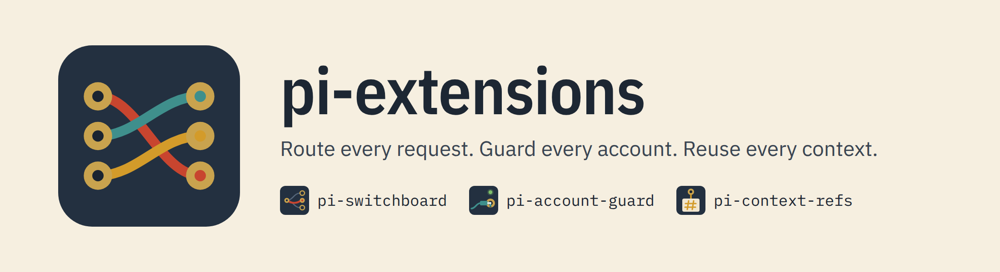
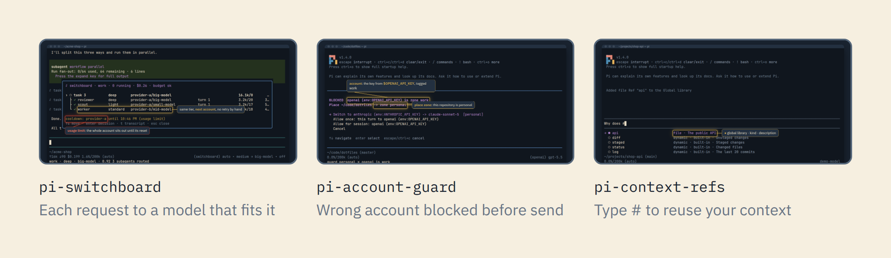

# pi extensions by @crisboarna

    

<picture>
  <source media="(prefers-color-scheme: dark)" srcset="https://raw.githubusercontent.com/crisboarna/pi-extensions/main/media/banner-dark.png">
  
</picture>

Extensions for the [pi](https://pi.dev) coding agent: pi-switchboard routes every request to a model that fits it, pi-account-guard keeps every turn on an account of the right zone, and pi-context-refs sends the context you keep retyping as a named ref. Each package installs on its own from npm.

**[The site](https://crisboarna.github.io/pi-extensions/)** has each package's docs, its demo video, an explainer that runs the package's own code on your config, and a live demo: real pi and the extension in a container in your browser.

<picture>
  <source media="(prefers-color-scheme: dark)" srcset="https://raw.githubusercontent.com/crisboarna/pi-extensions/main/media/hero-dark.png">
  
</picture>

| Package | What it does | Install |
|---|---|---|
| [`@crisboarna/pi-account-guard`](packages/pi-account-guard) | Stops a session from sending a turn to a model account that does not belong to the zone of the directory it works in, so a work subscription is never used in a personal repository by accident. Fails closed when it cannot decide. | `pi install npm:@crisboarna/pi-account-guard` |
| [`@crisboarna/pi-context-refs`](packages/pi-context-refs) | Saves the context you keep giving the model (a path, a file, a snippet, the output of a command or a URL) as named refs, and sends one when you type `#name` or pick it from a list. The editor shows a short `[ref:name]` placeholder; the content is read when you send. | `pi install npm:@crisboarna/pi-context-refs` |
| [`@crisboarna/pi-switchboard`](packages/pi-switchboard) | Picks a model for every piece of work, including pi-subagents children: a local classifier sets the tier, a strategy picks a model, failover keeps work going when a subscription runs dry, and every decision is recorded. | `pi install npm:@crisboarna/pi-switchboard` |

Restart pi after installing.

## Quality

Every package passes the same gates before it is published: strict TypeScript, lint and format, dead-code analysis, coverage thresholds, integration tests through pi's loader, an install-from-tarball smoke test, and a reviewed list of published files. Releases are published from CI with npm provenance, so each version traces back to the commit and workflow that built it. The full list is in [docs/guardrails.md](docs/guardrails.md).

## Contributing

See [CONTRIBUTING.md](CONTRIBUTING.md). Agents working in this repository start from [AGENTS.md](AGENTS.md). Report security issues privately as described in [SECURITY.md](SECURITY.md).

## License

[MIT](LICENSE)
