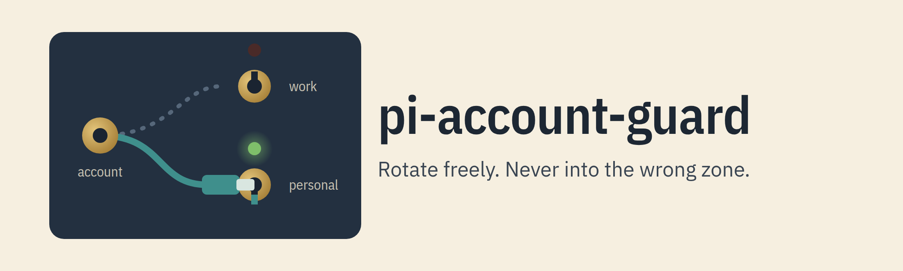

# @crisboarna/pi-account-guard

[](https://www.npmjs.com/package/@crisboarna/pi-account-guard) [](https://github.com/crisboarna/pi-extensions/actions/workflows/main.yml) [](https://github.com/crisboarna/pi-extensions/actions/workflows/main.yml) [](https://pi.dev) [](https://nodejs.org) [](https://github.com/crisboarna/pi-extensions/blob/main/packages/pi-account-guard/package.json) [](https://scorecard.dev/viewer/?uri=github.com/crisboarna/pi-extensions) [](LICENSE)

<picture>
  <source media="(prefers-color-scheme: dark)" srcset="https://raw.githubusercontent.com/crisboarna/pi-extensions/main/packages/pi-account-guard/media/banner-dark.png">
  
</picture>

Keeps each [pi](https://pi.dev) session on the accounts that belong where it runs: a work subscription never answers in a personal repository, and the other way round. Before each turn, the guard checks the account pi is about to use against the zone of the directory, and when they differ it blocks the turn and offers the fix in one keystroke. It is for anyone with work and personal subscriptions in one pi, especially with rotators and routers that change accounts on their own.

[](https://github.com/crisboarna/pi-extensions/blob/main/packages/pi-account-guard/media/hero.mp4)

▶ [Watch the demo, with narration (2:40)](https://github.com/crisboarna/pi-extensions/blob/main/packages/pi-account-guard/media/hero.mp4): real pi and pi-account-guard with throwaway accounts and repositories; only the model replies are scripted.

It is a guard against slips, not a security boundary: it never reads secrets, and when it cannot decide, it blocks.

## Install

```bash
pi install npm:@crisboarna/pi-account-guard
```

Restart pi.

## Quick start

With no config the guard knows two zones, `work` and `personal`, and every directory is `personal`.

1. In a work repository, run `/guard place add path=here zone=work`. This directory and everything below it are now `work`. For every repository of an organization, use its remote instead: `/guard place add remote=*/my-company/* zone=work`.
2. Send a prompt. The first time an account is used, the tag prompt asks which zones it belongs to. Tick `work`, and the turn goes at once.
3. Open a personal repository with the same account selected. The turn is blocked, and the select offers Switch rows for the accounts you tagged `personal`.
4. Run `/guard` at any time: it shows the place and the rule that decides it, the account and whether it matches. `/guard check <path>` asks the same about another directory, and `/guard tour` walks through it all with samples.

The footer shows the result as you work: `guard personal ✓`, or `guard personal ✗ openai is work` before a turn would be blocked.


### Agents and scripts

The package ships a skill, `pi-account-guard`, that pi loads with it. Ask the agent why a turn was blocked or how to set up your zones: it reads `account-guard.json` and your git remotes, explains the block in plain words and proposes `/guard` commands for you to run. It never proposes a way around a block. Scripts get exit code 77 and the reason on stderr when a headless run is blocked; see [headless use](docs/headless.md).

## What you get

- **Fails closed.** An untagged account, a broken config or a git failure blocks the turn and says why, instead of letting it through.
- **One-keystroke fix.** The block offers Switch to an account of this zone, Allow once, Allow for session, or Cancel, which puts your prompt back.
- **Tags itself on first use.** No config to write up front: each new account asks for its zones once.
- **Catches rotators and routers mid-turn.** A model change into the wrong zone during a turn (pi-multi-pass rotation, `/model`, a router fallback) aborts the turn and offers the previous account first.
- **Scripts can tell.** In print and JSON mode a block exits with code 77, with the reason on stderr.
- **Reads no secrets.** An account is a provider id plus its auth source, such as `env:OPENAI_API_KEY` or `oauth`, never the key itself.

## Configuration

One file, `~/.pi/agent/account-guard.json`, edited by `/guard` or by hand. The settings most people change:

| Setting | Effect | Default |
|---|---|---|
| `zones` | Every zone a tag or rule may name | `["work", "personal"]` |
| `defaultZone` | The zone of a directory no rule matches | `personal` |
| `accounts` | Tags: `provider`, `source` and its `zones` | none, so every account is untagged |
| `places` | Place rules by `path`, git `remote` or both; the first match wins | none |

The full format, validation and the JSON Schema are in [configuration](docs/configuration.md).

## Reference

- [Configuration](docs/configuration.md): the file, zones, accounts, place rules, validation and the JSON Schema.
- [Blocks](docs/blocks.md): the select, the tag prompt, and a model change during a turn.
- [Commands](docs/commands.md): every `/guard` command.
- [Footer](docs/footer.md): every footer text, and pi-powerline-footer.
- [Headless use](docs/headless.md): exit code 77, the process override and RPC.
- [With other extensions](docs/with-other-extensions.md): claude-bridge, pi-multi-pass, pooled providers and pi-switchboard.
- [Upgrading](docs/upgrading.md): what an upgrade keeps and how a breaking change is announced.
- [Benchmarks](docs/benchmarks.md): what loading the package adds to pi's start, measured and charted.
- [Alternatives](docs/alternatives.md): other extensions that protect a session in a nearby way, and when to choose them.
- [Troubleshooting](docs/troubleshooting.md) and [FAQ](docs/faq.md).
- [DESIGN.md](DESIGN.md), [GLOSSARY.md](GLOSSARY.md) and the [decision records](docs/adr/).

## Requirements

Node 22.19 or later; pi 1.4 up to, not including, 2.0, the range CI tests. Linux is tested in CI; macOS is checked by hand, not in CI; Windows is not tested, so use WSL.

| How pi runs | What the guard does | Exit code |
|---|---|---|
| Interactive | Checks every turn and every model change; a block opens a dialog with the ways out; the footer shows the state; `/guard` commands and `/guard tour` | none |
| Print (`-p`) and JSON | A block does not send the turn: the reason and the fix go to stderr | **77** |
| RPC | A block returns success with `disposition: "handled"`, and the message arrives as a `notify` request | none |

`PI_ACCOUNT_GUARD_ALLOW_UNKNOWN=1` lets an account with no tag through in print, JSON and RPC mode, and nothing else. See [docs/headless.md](docs/headless.md).

## Data and privacy

- **Network:** none. There is no telemetry and no update check.
- **Processes:** `git remote -v`, run in the directory pi is in, to read the repository's remotes. Nothing else.
- **Files it reads:** `account-guard.json` and `multi-pass.json` in the agent directory (the second only to name an account), and your git remotes. For a claude-bridge model it also reads `settings.json` in the Claude Code config directory (`CLAUDE_CONFIG_DIR`, else `~/.claude`) to see whether it defines an `apiKeyHelper`; it keeps only that yes or no.
- **Files it writes:** `account-guard.json`, when you run `/guard tag`, `place` or `zone`, in one step so that a crash cannot leave half a file; and `account-guard.first-run`, one line that records that the first-run notice was shown. Both are in the agent directory.
- **Credentials:** it asks pi whether a provider has a key and whether you signed in with OAuth. It never asks for a key itself, and it never reads `auth.json`.
- **Limits:** the config holds paths, remotes and account names in plain text. The guard is not a security boundary; see the [FAQ](docs/faq.md).

## Limitations

The guard checks the account pi is about to use at the moments below. It does not watch every request.

Not guarded in v1:

- `pi.sendMessage` turns while streaming, and extension `/commands` that start work.
- Retries and virtual-model re-routing that change the physical model without an event.
- Out-of-loop model changes (RPC `set_model`, the TUI selector) racing a running turn.
- Cache warmer keep-alive requests.
- Compaction and branch summaries.
- Subagent child processes and other extensions' own HTTP clients.

Known gaps in account identity, because detecting them needs secrets:

- Re-login into the same provider id as a different human account, a direnv-swapped key under the same variable name, and an `auth.json` edit made outside pi (seen one refresh late).
- A claude-bridge credential defined only in the `env` block of Claude Code's own `settings.json`.
- Pooled providers: the guard only warns.
- The members behind a virtual model whose router does not list them on the event bus. pi-switchboard lists them, and the guard checks each one's account ([with other extensions](docs/with-other-extensions.md)).

Also: the place zone is cached at session start (a hand edit of `places` or a remote change needs `/reload`), and a rule written against a symlink alias of a directory does not match. See [DESIGN.md](DESIGN.md) sections 14 and 15.

## Uninstall

```bash
pi remove npm:@crisboarna/pi-account-guard
```

Then delete `account-guard.json` and `account-guard.first-run` from the agent directory (`~/.pi/agent/`) if you want them gone. Without the package, nothing checks which account a turn uses.

## Development

The package lives in the [pi-extensions](https://github.com/crisboarna/pi-extensions) monorepo. Run `npm install` and `npm run check` from the repository root; the root supplies the pi host packages and the tooling.

```sh
npm test --workspace @crisboarna/pi-account-guard                  # unit tests on the pure core (src/core)
npm run test:integration --workspace @crisboarna/pi-account-guard  # fake-pi host loading src/index.ts through jiti
npm run test:smoke --workspace @crisboarna/pi-account-guard        # opt-in: real pi, offline, with the stub provider
```

The smoke tests run the `pi` on `PATH` (override with `PI_BIN`) with `PI_OFFLINE=1`, an empty agent directory and credential environment variables removed. `test/support/stub-provider.ts` answers every prompt locally. The checks that need a real TUI are in [docs/manual-checklist.md](docs/manual-checklist.md); they run as simulated terminal scenes with `npm run media`.

## License

[MIT](LICENSE)
