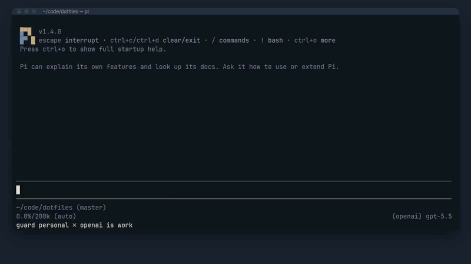
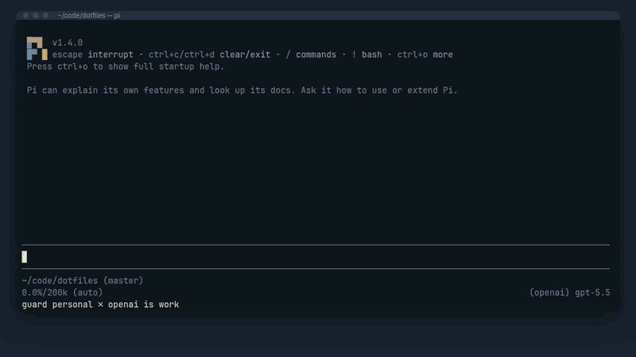
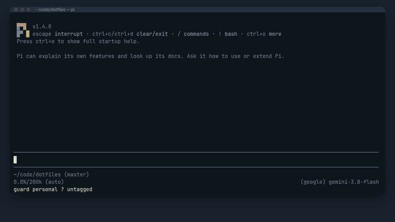
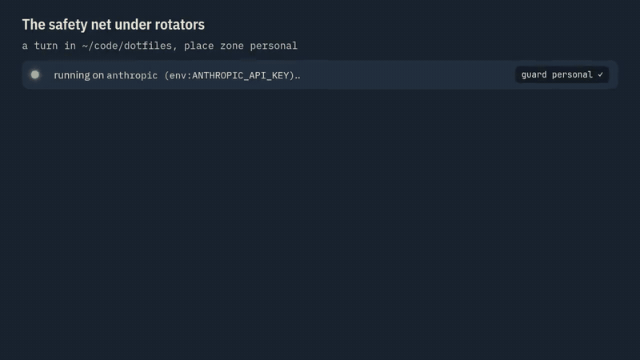
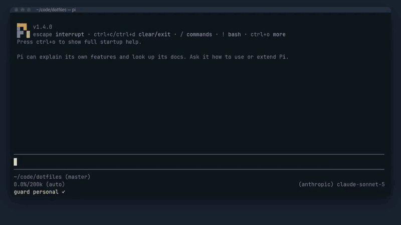

# Blocks

What happens when a turn is blocked: the select, the tag prompt for an untagged account, and a model change while a turn runs. Without a UI, see [headless use](headless.md).

## The select



In the TUI and over RPC a block opens one select:

```text
BLOCKED  openai (env:OPENAI_API_KEY) is zone work
Place ~/code/dotfiles -> zone personal

 > Switch to anthropic (env:ANTHROPIC_API_KEY) -> claude-sonnet-5  [personal]
   Allow once: this turn to openai (env:OPENAI_API_KEY)
   Allow for session: openai (env:OPENAI_API_KEY)
   Cancel
```

- **Switch** rows list the accounts tagged with the place zone whose auth is configured now. Choosing one switches the model and sends the same prompt.
- **Allow once** lets this one turn through, after a confirm.
- **Allow for session** lets the rest of the session use this one account. The footer then shows `guard OVERRIDE <account> in <zone>`. Neither override is written to disk. Both end with the session, and `/new`, `/resume`, `/fork` and `/reload` start with none.
- **Cancel** puts the typed prompt back in the editor. Over RPC, no answer counts as Cancel.



## The tag prompt



An account with no tag is in the Unknown zone, and the **tag prompt** opens first: a checkbox list in the TUI, a select of single zones plus a `Several zones…` input over RPC. A tag that gives a Match sends the turn at once. The prompt is off while the config file is malformed.

## A model change during a turn



A model change while a turn runs (rotation by pi-multi-pass, `/model`, a router fallback) aborts the turn with a notice that says a failover was blocked. Once idle, the same select opens with the previous account first and without Allow once. Cancel leaves the model as it is. The aborted turn is never resumed.

The same in a real session, with `/model` standing in for the rotator:



Why an undecidable case blocks instead of passing: [ADR 0001](adr/0001-fail-closed-when-undecidable.md).
