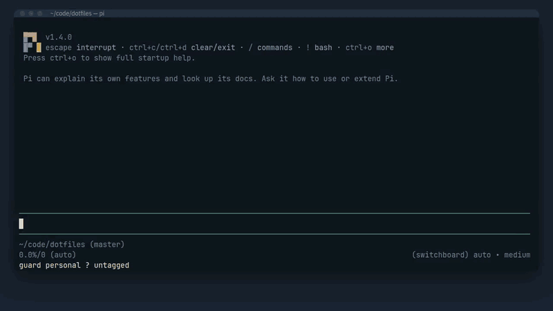

# With other extensions and providers

The guard checks the account behind the model pi is about to use, so it works with anything that changes models through pi. How it treats the common cases:

## claude-bridge

A claude-bridge model takes its account from the environment key variable that Claude Code would use (`env:<VAR>`), else from the resolved `CLAUDE_CONFIG_DIR` (`~/.claude` by default), so a work and a personal config directory are different accounts. Cloud provider and `apiKeyHelper` setups share one `claude-code` account. The guard reads `settings.json` only to check that `apiKeyHelper` is set.

## pi-multi-pass

Rotation goes through `pi.setModel`, so the guard catches it as a model change. The guard does not depend on multi-pass's own allow list.

## pi-multiprovider pools

A provider id that pools several accounts gets a warning in the tag prompt: tag it only if all of them share one zone. A pool alone never blocks.

## Virtual routing models

such as `switchboard/auto` are checked through the models behind them. pi-switchboard lists every model a virtual model can route to, including the account siblings failover can move to, and the guard checks each one's account: a turn runs only when every one of them is in the place's zone. The Block names the member that is not, so you tag that account, not `switchboard/auto`. `/guard check here` lists every member with its account before you send a turn. A router that does not list its members is checked as one account, tagged like any other; tag it only with zones in which every possible member is allowed.

An account is a provider id plus its auth source ([ADR 0002](adr/0002-account-is-provider-id-plus-auth-source.md)); the members behind a virtual model are checked when its router lists them ([ADR 0006](adr/0006-check-every-member-a-router-lists.md)), and a virtual model is its own account when it does not ([ADR 0004](adr/0004-virtual-model-is-its-own-account.md)).
