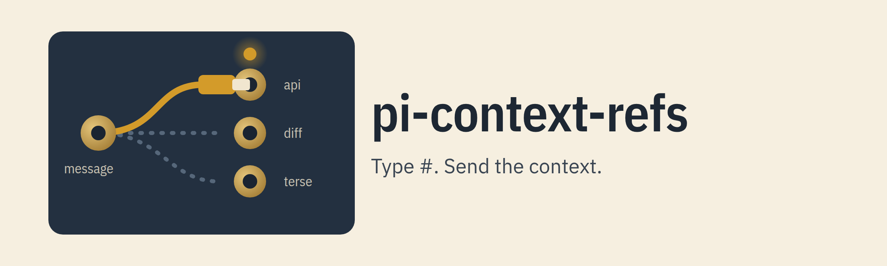
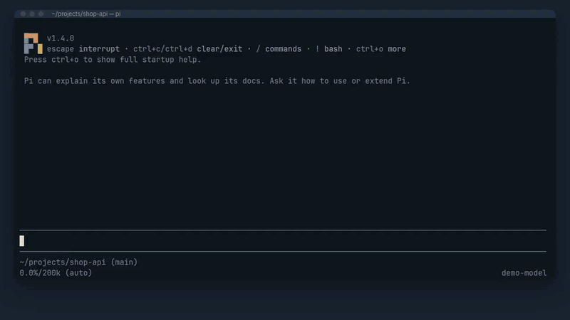
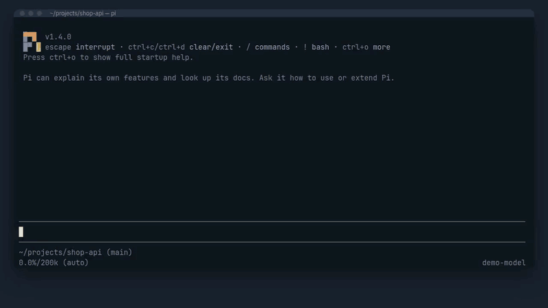

# @crisboarna/pi-context-refs

[](https://www.npmjs.com/package/@crisboarna/pi-context-refs) [](LICENSE)

<picture>
  <source media="(prefers-color-scheme: dark)" srcset="https://raw.githubusercontent.com/crisboarna/pi-extensions/main/packages/pi-context-refs/media/banner-dark.png">
  
</picture>

Save the context you keep giving the model (a path, a file, a snippet of text, the output of a command or a URL) as named refs, and send one by typing `#name` or picking it from a list. The editor shows a short `[ref:name]` placeholder; the real content is read when you send the message. It adds a `#` picker, an `alt+r` overlay with a preview, and the `/ref` command to [pi](https://pi.dev). It is for anyone who retypes the same paths, pastes the same files or copies in `git diff` by hand, and for teams that want to share the context a repository needs.

[![A narrated demo in a real pi session: save a file as a ref, type # to open the picker, pick api, see the [ref:api] placeholder deleted by one Backspace, send, and see one collapsed line in the transcript, then #diff, the alt+r overlay and /ref sent. This loop plays the main moments without sound; click for the full video.](https://raw.githubusercontent.com/crisboarna/pi-extensions/main/packages/pi-context-refs/media/hero-loop.gif)](https://github.com/crisboarna/pi-extensions/blob/main/packages/pi-context-refs/media/hero.mp4)

▶ [Watch the one-minute demo, with narration](https://github.com/crisboarna/pi-extensions/blob/main/packages/pi-context-refs/media/hero.mp4): real pi and pi-context-refs; only the model replies are scripted.

## Install

```bash
pi install npm:@crisboarna/pi-context-refs
```

Restart pi. Requires Node 22.19 or later and pi 1.4 up to, not including, 2.0.

## Quick start

1. Save a file as a ref: `/ref add api file src/api.ts desc="The public API"`. Pi answers `Added file Ref "api" to the Global library`.
2. In pi's editor, type `#`. A list of your refs opens, with a mark for the library each one comes from, its name, its kind and its description. Pick `api`.
3. The draft now holds `[ref:api]`. One Backspace deletes the whole placeholder, and the cursor skips over it.
4. Type your question around it, for example `Why does [ref:api] retry twice?`, and send.
5. The model gets the current text of `src/api.ts` in a `<context-ref>` block after your message. The transcript shows one line for it: `▸ ref api (file, 1.8 KB)`.

![Typing # in pi's editor opens a list of refs with the api ref first, then narrows it to terse as te is typed, and a Tab inserts the [ref:terse] placeholder.](https://raw.githubusercontent.com/crisboarna/pi-extensions/main/packages/pi-context-refs/media/picker.gif)

![The draft Why does [ref:api] retry twice? holds the placeholder as one unit; the cursor skips over it and one Backspace deletes all of it.](https://raw.githubusercontent.com/crisboarna/pi-extensions/main/packages/pi-context-refs/media/placeholder.gif)

Four refs work with no setup: `#diff`, `#staged`, `#status` and `#log` send git output inside a git work tree.



You can also type the ref by hand. `Review #diff` and `Review [ref:diff]` mean the same, and they work in print, JSON and RPC mode too, where there is no picker.

## What you get

- **Context without retyping.** A ref is a Path, a File, a Snippet or a Dynamic ref (a command or a URL), saved once with `/ref add`.
- **A draft you can read.** A pick inserts `[ref:name]`, and the editor treats it as one unit, so you cannot half-delete it.
- **Fresh content.** Every ref is read when you send, never when you pick, so the model never gets a stale copy.
- **Safe commands.** A command is an argv array run with no shell. A command or URL in a project's shared library runs only after you approve its exact definition.
- **Shared with a team.** `.pi/pi-context-refs.json` in a trusted project holds refs for everyone; your own refs stay in your agent directory and can be scoped to one repository.
- **A preview before you send.** `alt+r` opens an overlay with a filter and the expansion of the selected ref. It also saves files this session used as refs.
- **A short transcript.** Each block collapses to one line, and `/ref sent` shows the full text of the last message.

## Configuration

Your library is `~/.pi/agent/pi-context-refs.json` (in the directory `PI_CODING_AGENT_DIR` names, when set). `/ref add`, `edit` and `remove` write it; you can edit it by hand, and a change is picked up at the next send. Add `"$schema": "https://raw.githubusercontent.com/crisboarna/pi-extensions/main/packages/pi-context-refs/schema/pi-context-refs.schema.json"` and your editor validates it.

A team library is `.pi/pi-context-refs.json` in the project, written with `/ref add … in=project`. It loads only when pi trusts the project, and its paths must stay inside the project.

Two settings sit beside `refs` in your own file. `/ref list` shows them; there is no command to set them.

| Setting | Effect | Default |
|---|---|---|
| `trigger` | The character that opens the picker. One character; not `/`, `@`, `!` or a space. A change needs `/reload`. | `#` |
| `builtins` | `false` turns off `#diff`, `#staged`, `#status` and `#log`; a list of names turns off just those. | all four on |

Limits per ref: `max_bytes` for a File (default 50 KB, up to 1 MB); `timeout` (default 10 s, up to 120 s) and `max_output` (default 50 KB, up to 1 MB) for a Dynamic ref. A saved ref with the name of a built-in replaces it.

When two refs share a name, the order is: scoped ref, project library, your unscoped ref, built-in. `/ref list` names the ones that are hidden.

### Commands

| Command | Does |
|---|---|
| `/ref list [tag=<tag>] [in=<library>]` | Settings, refs by library, hidden refs, built-ins, warnings and the approval state of each project command |
| `/ref add <name> <kind> <target…> [desc=<text>] [tags=a,b] [in=<library>]` | Kind is `path`, `file`, `snippet` or `dynamic`; `in=` is `global` (default), `project` or `here` (your library, scoped to this repository) |
| `/ref edit <name> [key=value…]` | With no pairs, opens the ref as JSON in an editor |
| `/ref remove <name>` | Removes the ref after a confirm |
| `/ref approvals`, `/ref approve <name>`, `/ref revoke <name\|*>` | Show, grant or drop approvals of project commands and URLs (granting needs the TUI) |
| `/ref sent` | The full expansions of the last message you sent |

Tag refs with `tags=a,b`, then `#tag:<tag>` sends every visible ref with that tag, and picking a bundle in the list inserts one placeholder per member.

### Keys in the overlay



`alt+r` opens it. Enter picks, Tab switches a recent file between its path form and its file form, Ctrl+S saves a recent file as a ref, Ctrl+E edits and Ctrl+D removes a saved ref, Esc closes. A pick after a typed `#` replaces that `#`.

## Reference

- [DESIGN.md](DESIGN.md): the full design, with the pi behaviour it relies on (section 16.1) and the known limits (section 17).
- [GLOSSARY.md](GLOSSARY.md): the terms used here and in the code.
- [docs/adr/](docs/adr/): the six decisions that are hardest to reverse.
- [docs/manual-checklist.md](docs/manual-checklist.md): the checks that need a person at a real terminal, and their status.
- [schema/](schema): JSON Schemas for the library files and the approvals file.

## Troubleshooting

| Symptom | Cause | Fix |
|---|---|---|
| `#` opens nothing | Another extension replaced the editor or owns the key, or a space follows the `#` | Set `trigger` to another character and run `/reload`; `alt+r` always works |
| The project library is missing | Pi does not trust the project | Run `/trust`, then restart pi: a saved decision applies from the next start |
| A project command shows `(pending)` | You have not approved its definition | Run it from the TUI and answer the question, or run `/ref approve <name>` |
| A placeholder is sent as typed | No visible ref has that name now | Run `/ref list`; the ref may be removed, out of scope or in an untrusted library |
| `/ref` prints nothing in `pi -p` | Pi shows no extension notices there | The output is on stderr |

## Limitations

- A path used only through `bash` or `ls` never becomes a recent file, and files outside the project never do.
- The stored message holds the full expansion, so the fork selector, the editor after a fork, up-arrow after a resume, HTML export and a compaction summary show it in full. Only the live transcript collapses it. Pi gives user messages no expand control, so use `/ref sent`.
- The placeholder relies on one private method of pi's editor. A pi upgrade can turn it into plain text, which still expands on send; a contract test in this package checks it on every build.
- Text in a snippet or path is escaped, so it cannot pass for a block. The content of a file, command or page that contains `</context-ref>` is not; the block's byte length keeps the transcript right.
- Images are attached at their original size.
- Content is never refreshed after the message is sent: a resent message keeps the block it had.
- A snippet cannot contain refs.
- Approving a project command or URL approves the command line or the address only. A changed script, Makefile, `package.json` or page runs without asking again, and a command runs with your environment.
- The built-in refs run `git` without asking, in a repository whose `.git/config` can be hostile.
- A global ref scoped by `remote` applies wherever `.git/config` names that remote, and a hostile clone can name any remote.
- A redirect is judged by the host's text and by the addresses its name resolves to when it is looked up, not at the moment of connection. A link in a project that changes between the check and the read still wins that race.
- Two pi sessions that save a ref or an approval at the same moment can lose one of the changes; a lost approval is asked for again.
- A foreground pi-subagents child cannot be told from `pi -p`, so refs in the task text the parent model writes for it expand there. A background child is skipped.
- A very long command in the approval prompt can scroll its first lines off a short terminal.
- A project ref silently hides a global or built-in ref of the same name; `/ref list` names the hidden ones.
- A text file is read up to 16 MB; a bigger one is cut at its cap and the closing line gives no line total.
- `@` completions only see files that appeared in sent text, and each extension gets one Markdown transformer.
- A `#word` in prose that matches a ref name expands, so a ref named `todo` makes every `#todo` expand.
- Another extension that reads the user message (a classifier, a guard) sees the full expansion.
- Not yet checked by a person in a real terminal: the look of the list and the overlay at narrow widths and in themes, fork, resume, export and compaction, `ctrl+o`, the wording of the approval prompt, and living beside pi-image-view, pi-up-history, pi-cc-steer, pi-multi-pass and pi-powerline-footer. The list is in [docs/manual-checklist.md](docs/manual-checklist.md).

## License

[MIT](LICENSE)
