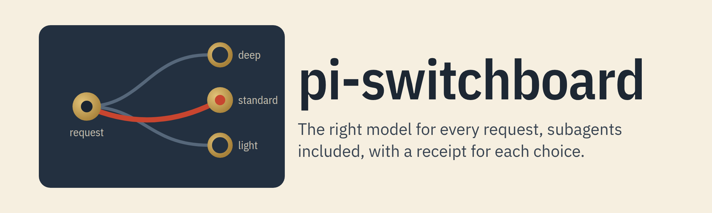
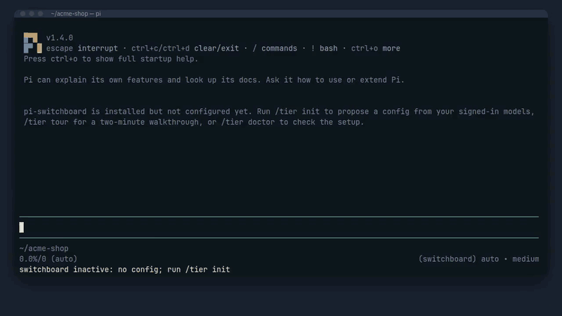
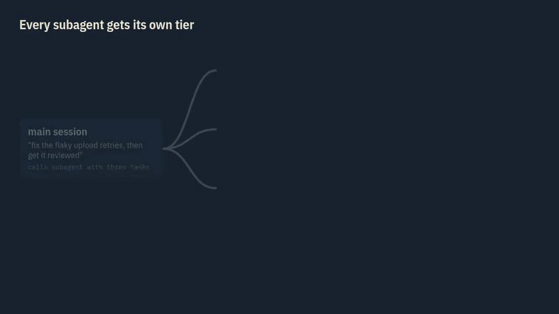

# @crisboarna/pi-switchboard

[](https://www.npmjs.com/package/@crisboarna/pi-switchboard) [](https://github.com/crisboarna/pi-extensions/actions/workflows/main.yml) [](https://github.com/crisboarna/pi-extensions/actions/workflows/main.yml) [](https://pi.dev) [](https://nodejs.org) [](https://github.com/crisboarna/pi-extensions/blob/main/packages/pi-switchboard/package.json) [](https://scorecard.dev/viewer/?uri=github.com/crisboarna/pi-extensions) [](LICENSE)

<picture>
  <source media="(prefers-color-scheme: dark)" srcset="https://raw.githubusercontent.com/crisboarna/pi-extensions/main/packages/pi-switchboard/media/banner-dark.png">
  
</picture>

Every request in [pi](https://pi.dev) goes to a model that fits it: small jobs to small models, design and review to the strongest, and each subagent to its own tier. A local classifier answers three questions about the request, your rules turn the answers into a tier, and a strategy picks one of the tier's models, moving to another account when a subscription runs dry. Every choice is recorded, so you can see why each model ran and what it cost.

[](https://github.com/crisboarna/pi-extensions/blob/main/packages/pi-switchboard/media/hero.mp4)

▶ [Watch the two-minute demo, with narration](https://github.com/crisboarna/pi-extensions/blob/main/packages/pi-switchboard/media/hero.mp4): real pi, pi-switchboard and pi-subagents; only the model replies are scripted.

## Install

```bash
pi install npm:@crisboarna/pi-switchboard
```

Restart pi.

## Try it first

None of these runs a model; only `/tier init` writes a file, after you confirm the diff:

```text
/tier tour                                      # a two-minute walkthrough with sample decisions
/tier init                                      # propose a config from your signed-in models; shows the diff first
/tier try rename foo to bar in utils.ts         # how this request would route
/tier try work=plan depth=1.8 risky=no design the billing service   # the same with typed answers, no classifier needed
/tier doctor                                    # check the setup, with what to fix
```



Then pick `switchboard/auto` in `/model`. To watch decisions before trusting them, `/tier dry-run on` classifies and records every request but runs your baseline tier ([see it](https://raw.githubusercontent.com/crisboarna/pi-extensions/main/packages/pi-switchboard/media/dry-run.gif)).

The classifier is a small local model (about 0.2–0.7 s per decision on a GPU): `pi-switchboard classifier detect` finds one already running and `pi-switchboard classifier setup <lmstudio|ollama|llamacpp|llamacpp-chat>` sets one up, or follow [classifier setup](docs/classifier-setup.md) for LM Studio, llama.cpp, Ollama, MLX or a hosted classifier such as GPT-6 Luna. Without one, requests use your fallback tier and everything else still works.

## What you get

- **The right model per request**: three typed answers (what kind of work, how deep, how risky) and your rules pick the tier, with a confidence gate so an unsure answer never sends a design task to a small model.
- **Subagents routed too**: each [pi-subagents](https://www.npmjs.com/package/pi-subagents) task gets its own tier, and pi-switchboard runs inside every child, so failover and escalation work there as well.
- **Work keeps going when a limit hits**: several models per tier, a usage limit benches the whole account, a rate limit benches the model, and a tier with nothing left borrows from its neighbour.
- **A receipt for every choice**: the answers, the rule, the tier and why that member was picked, in `/tier explain`, a live navigator, and an offline HTML inspector that also estimates what a task would have cost on another tier.
- **Private, cheap decisions**: the classifier runs on your machine, request text is redacted before it sees it, and remote classifiers are opt-in.
- **Your models, your rules**: any provider pi supports, 15 selection strategies, custom rulesets and thresholds; the source names no provider or model.

## How a decision is made

1. The request, the plan phase and recent tool outcomes go to the local classifier, redacted.
2. It answers `work` (plan, research, implement, review, mechanical), `depth` (0 to 2) and `risky` (yes or no), each with a confidence.
3. The first matching rule picks a tier; if its answers are not confident enough, the fallback tier runs instead. Floor rules can raise the tier: in the built-in rules, confidently risky work runs on at least the middle tier.
4. The tier's strategy picks a healthy member: cooling-down members sit out, and the previous member is kept so the prompt cache survives.
5. The request runs on that model, and the decision is recorded next to the conversation, outside the model's context.


`/tier explain` prints the same reasoning for any real decision ([see it](https://raw.githubusercontent.com/crisboarna/pi-extensions/main/packages/pi-switchboard/media/explain.gif)).

More: [rules and confidence](docs/rules-and-confidence.md), [strategies and failover](docs/strategies-and-failover.md).

## When a subscription runs dry


pi does not retry a usage-limit error itself, so pi-switchboard moves the request to another member when one can take over, and keeps the original error in the record. When every tier is out, the turn ends with the earliest reset, and opt-in auto-continue resumes then.

## Subagents



Each task of a `subagent` call is classified at launch and given a tier-pinned model such as `switchboard/work.deep`, within the agent's own limits. Explicit models, agent frontmatter and external runners are never overridden. `Ctrl+Alt+W` opens a live navigator over the children ([see it](https://raw.githubusercontent.com/crisboarna/pi-extensions/main/packages/pi-switchboard/media/watch.gif)). [How it works](docs/subagents.md).

## How it compares

Model routing for pi usually takes one of three approaches:

- **Decide once per session.** Cache-friendly and cheap, but a session that starts with a small question stays on the small model when the work gets hard.
- **Decide every turn, one model per tier.** Adapts to the work, but one rate limit stops the tier, and subagents are usually left on their own model.
- **Rotate accounts on limits.** Keeps work going, but every request runs on the same kind of model, whatever it is.

pi-switchboard decides per request with a confidence gate, holds several models per tier with a strategy and shared health, fails over by account, model or tier, and adds three things these approaches leave out: routing inside each subagent, a recorded explanation of every choice with an inspector, and previews (`/tier try`, dry-run) before you trust it.

## Configuration

`~/.pi/agent/pi-switchboard.json`, written by `/tier init` and edited by `/tier models` or by hand ([schema](schema/pi-switchboard.schema.json)).

| Setting | Effect |
|---|---|
| `profiles.<name>.tiers.<tier>.members` | which models a tier may use |
| `profiles.<name>.tiers.<tier>.strategy` | how a tier picks a member (default `sticky`) |
| `classifiers[].threshold` | how sure the classifier must be before a rule fires (default 0.85) |
| `profiles.<name>.ruleset` | which answers map to which tier (default: the built-in ruleset) |
| `subagents.agents.<agent>` | `minTier`, `maxTier` or `fixedTier` for a subagent |

A trusted project may add or adjust profiles in `.pi/pi-switchboard.json`; it can never change classifiers. Four [examples](examples/) cover two subscriptions, mixed providers, local-only models and a single tier; try one with `PI_SWITCHBOARD_CONFIG=examples/<file>.json pi`.

## Reference

- [Classifier setup](docs/classifier-setup.md): choosing a route, `classifier detect`, `setup` and `eval`, tuning, remote classifiers, what the classifier sees; one page each for [LM Studio](docs/classifier-lm-studio.md), [llama.cpp](docs/classifier-llama-cpp.md), [Ollama](docs/classifier-ollama.md), [MLX](docs/classifier-mlx.md), [cloud classifiers](docs/classifier-cloud.md) and [other servers](docs/classifier-other-servers.md), and [the models compared](docs/classifier-models.md).
- [Configuration](docs/configuration.md): profiles, tiers, members, profile selection, virtual models, project files.
- [Rules and confidence](docs/rules-and-confidence.md): the built-in ruleset, writing rules, thresholds, tuning.
- [Strategies, failover and quota](docs/strategies-and-failover.md): every strategy, error classes, borrowing, pi-usage, budgets.
- [Subagents](docs/subagents.md): launch classification, child and launch mode, agent limits, accounts.
- [Commands](docs/commands.md): every `/tier` command and its output.
- [Footer](docs/footer.md): the powerline items and placeholders.
- [Inspector, replay and report](docs/inspector.md): the HTML inspector and the `pi-switchboard` CLI.
- [Upgrading](docs/upgrading.md): what an upgrade keeps and how a breaking change is announced.
- [Benchmarks](docs/benchmarks.md): what loading the package adds to pi's start and how long a routing decision takes, measured and charted.
- [Alternatives](docs/alternatives.md): other routers and failover tools, and when to choose them.
- [Troubleshooting](docs/troubleshooting.md) and [FAQ](docs/faq.md).
- Design of record: [DESIGN.md](DESIGN.md), terms: [GLOSSARY.md](GLOSSARY.md), decisions: [docs/adr/](docs/adr/).

## Requirements

Node 22.19 or later; pi 1.4 up to, not including, 2.0, the range CI tests. Linux is tested in CI; macOS is checked by hand, not in CI; Windows is not tested, so use WSL.

| How pi runs | What works | What does not |
|---|---|---|
| Interactive | Routing, failover and subagent tiers, every `/tier` command, the tier editor, the navigator and the footer | |
| Print (`-p`) | Routing and failover, tested with real prompts | `/tier` output, which print mode does not show. Use the `pi-switchboard` CLI |
| RPC | Routing and failover, tested through pi's RPC mode | The editor and the navigator, which need a screen |

JSON mode is not tested on its own. The `pi-switchboard` CLI needs no pi at all.

## Data and privacy

- **Network:** requests go only to a classifier you configured: a local server, or a cloud model through a pi provider. `/tier doctor` sends the configured classifier one test request. `pi-switchboard classifier detect` reads the model lists of the three default local servers (Ollama on `127.0.0.1:11434`, LM Studio on `127.0.0.1:1234`, llama.cpp on `127.0.0.1:8080`) and sends one test request to a decision model it finds. `classifier setup` reads the same lists while it waits for a server, tests once it is ready, and can ask a router to load a model. `classifier eval` sends 24 labelled requests to the classifier you name. There is no telemetry and no update check.
- **Processes:** `classifier setup` shows the install and server commands, and asks before it runs them and before it writes the config, unless you pass `--yes`. `/tier inspect --open` opens the HTML it wrote with the platform's file opener (`open`, `xdg-open` or `cmd /c start`).
- **What the classifier sees:** the request text and short tool errors, redacted once (the home directory and common token, key and password shapes) before they reach the classifier, the session entry or any log. Errors a provider or a classifier sends back are redacted the same way before they are recorded. The rules match known shapes, not every secret: add your own with `classification.evidence.redact`.
- **Files it reads:** the config (`pi-switchboard.json` in the agent directory, and the nearest `.pi/pi-switchboard.json` from the project upward), `multi-pass.json` for account names only, pi-subagents agent files for their front matter, and session files for `inspect` and `reclassify`. pi-usage answers over pi's event bus; this package makes no request for it.
- **Files it writes** under `~/.pi/agent/pi-switchboard/`: `health.json` (shared cooldowns and pointers), `usage.jsonl` (usage ledger), `state.json` (global profile and one-time notices), `live/` (subagent status and transcript mirrors, deleted 24 hours after a child ends), `inspect/` (the HTML inspector), and `decisions.jsonl` (only with `debug.log`). `/tier models` and `classifier setup` write the config; the editor saves a timestamped `.bak` copy first.
- **Credentials:** it never reads `auth.json` or other credential files.

## Limitations

- **Workflow-script children** (`workflow: true`, `runs.run`, `runs.all`) get no tier at launch: their script text comes from the model's reply, so no hook can change it. pi-switchboard still runs inside each child and classifies its first request there.
- **Exact child linking needs the next pi-subagents release** after 0.82.1 ([#3049](https://github.com/nicobailon/pi-subagents/pull/3049), merged); before that, foreground children are matched to their launch by agent and start time. Routing works on every version.
- **Agents with an external runner** (`claude-code`, `codex-exec`) are never routed.
- **`/model` lists every tier** of every profile as `switchboard/<profile>.<tier>`.
- **`/tier` output uses pi's notifications**, which print mode (`pi -p`) does not show.
- **The tier editor's save** is tested with keystrokes in real pi on a virtual terminal, including the diff, the write and the `.bak` copy; nobody has saved a real config with it at a real terminal yet. Real pi-subagents children, the navigator, `/tier init`, dry-run, pin and report were run live for the [terminal clips](docs/commands.md#in-a-session).
- **Quota data is best effort**: the first decision after start-up may run before pi-usage answers, and then the quota strategy's fallback chooses.

## Uninstall

```bash
pi remove npm:@crisboarna/pi-switchboard
rm -rf ~/.pi/agent/pi-switchboard ~/.pi/agent/pi-switchboard.json
```

Remove the footer items if you added them.

## Development

This package lives in the [pi-extensions](https://github.com/crisboarna/pi-extensions) monorepo. Run `npm install` at the repository root, then from this folder:

```bash
npm test                   # unit tests (node --test)
npm run test:integration   # loads the extension through jiti against a fake pi host
npm run coverage           # unit and integration tests, 90% line, branch and function thresholds
npm run test:e2e           # from the packed tarball, in real pi: the classifier CLI and commands, routing, failover and subagents
E2E_SERVERS=docker npm run test:e2e   # adds classifier setup against Ollama, llama.cpp and LiteLLM in Docker
npm run media              # rebuilds the banner, cover, animations, hero video and terminal clips (Docker)
```

Repository-wide gates run from the root with `npm run check`; see the root [CONTRIBUTING.md](../../CONTRIBUTING.md). `test/support/lmstudio-chat.ts` registers LM Studio's chat models as a pi provider for free local end-to-end runs:

```bash
PI_SWITCHBOARD_CONFIG=/path/to/local.json pi -ne -e ./src/index.ts -e ./test/support/lmstudio-chat.ts \
  --model switchboard/auto -p "rename foo to bar"
```

## License

[MIT](LICENSE)
