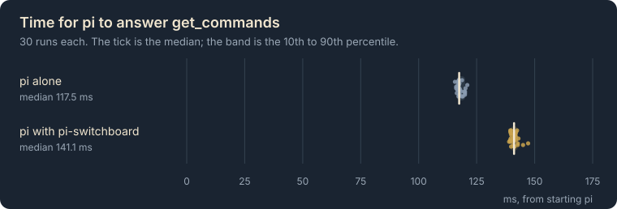
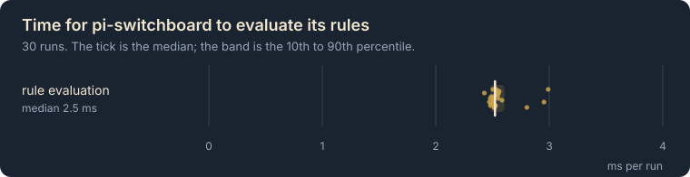

# Benchmarks

What pi-switchboard costs in time, measured and not estimated. Every number and chart on this page is generated from the recorded runs in `benchmarks/` by `npm run charts`.

## Start

| | Median | 10th to 90th percentile | Runs |
|---|---|---|---|
| pi alone | 117.5 ms | 116.4 to 120.0 ms | 30 |
| pi with pi-switchboard | 141.1 ms | 139.5 to 142.7 ms | 30 |

Loading pi-switchboard adds about 23.7 ms to pi's start (the difference of the two medians).

## Routing decision

| | Median | 10th to 90th percentile | Runs |
|---|---|---|---|
| 4800 rule evaluations | 2.5 ms | 2.5 to 2.6 ms | 30 |

That is about 0.53 µs for one decision (the median divided by 4800). It is the rule step after the classifier has answered; the classifier's own time depends on the model server and is not measured here.

## How it was measured

- **baseline:** Real pi in RPC mode on an empty agent directory with no extension loaded; wall time from spawn to the get_commands answer. What each package's load time is read against.
- **load:** Real pi in RPC mode on an empty agent directory with the extension loaded; wall time from spawn to the get_commands answer.
- **route:** Rule evaluation of the 24 calibration requests, 200 times over, in one process.
- **Machine:** Node 24.19.0 on darwin arm64 with 18 CPUs, pi 1.4.0.
- **Code:** commit `42a85c6`, measured 2026-11-03.
- **Again:** `node scripts/bench.ts --samples 30 --write benchmarks`, then `npm run format` and `npm run charts`.

## What this does not tell you

- It is one machine. Another machine is slower or faster; the latency job in CI compares a change with its base on one machine and publishes no absolute numbers.
- The start time runs from starting pi to its first answer over RPC, not to the first reply from a model.
- A difference of a few milliseconds is inside the spread of the runs.
