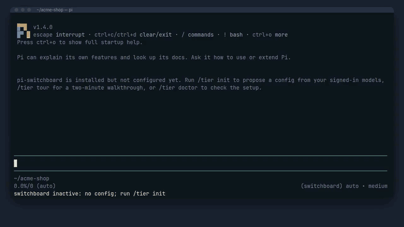
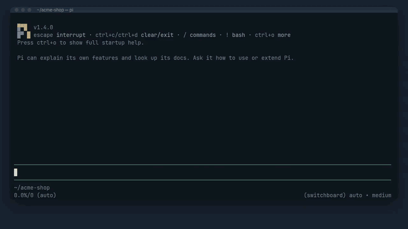
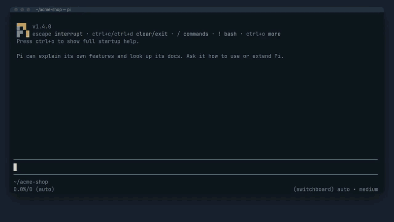
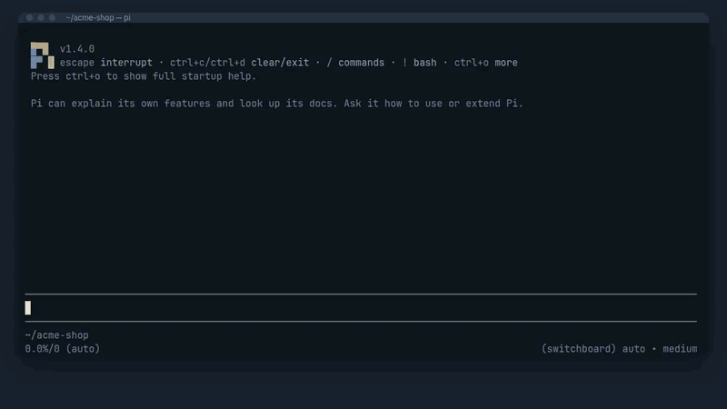
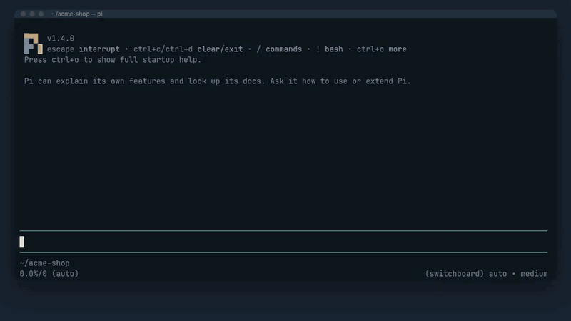
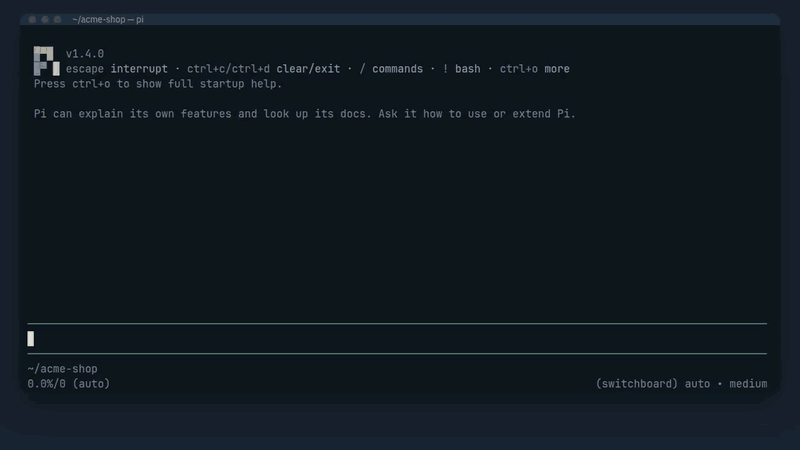

# Commands

| Command | Does |
|---|---|
| `/tier` | Status: whether routing is on, the active profile and why, the last decisions |
| `/tier tour` | A two-minute walkthrough of what pi-switchboard records, with sample decisions |
| `/tier try <request>` | How a request would route, without running it or changing any state |
| `/tier try work=plan depth=1.8 risky=no <request>` | The same with answers you type, for when no classifier is reachable or to test a rule |
| `/tier doctor` | Checks config, classifiers (with a warm-up request), model selection, subagents, footer and pi-usage, and says what to fix |
| `/tier init` | Proposes a config from your signed-in models, shows the diff, then writes it |
| `/tier models` | Edits profiles, tiers and members (diff and `.bak` before saving) |
| `/tier watch` or `Ctrl+Alt+W` | Live navigator: running tasks and subagents, their decisions and transcripts |
| `/tier profile <name\|auto> [--global]` | Chooses the profile for this session, or for every session |
| `/tier pin <tier\|@top\|@middle\|@bottom\|auto> [--subagents]` | Pins a tier, skipping classification |
| `/tier dry-run on\|off` | Classifies and records, but runs the baseline tier |
| `/tier log [n]`, `/tier explain [id]` | Recent decisions, and the full reasoning of one |
| `/tier health` | Cooldowns, requests in flight, latency |
| `/tier report`, `/tier budget` | Cost by tier, model and task; spend against budgets; the confidence histogram |
| `/tier inspect [--open] [-o file]` | Writes the offline HTML inspector for this session, with subagent transcripts |
| `/tier validate` | Checks the config |
| `/tier resume cancel` | Cancels a pending auto-continue |

`Ctrl+Alt` shortcuts need Ghostty's `macos-option-as-alt` on macOS; change the key with `ui.navigator.shortcut`.

`/tier` output goes through pi's notifications, which print mode (`pi -p`) does not show.

## In a session

Each clip is a real pi session with pi-switchboard; only the classifier's answers and the model replies are scripted (`media/terminal/scenes/demo.ts`).

`/tier init` proposes a config, shows the diff, and writes it after you confirm:



`/tier dry-run on` records what each request would have used while the baseline tier runs; `/tier log` lists them:



`/tier explain` shows the reasoning behind a decision, here a planning request the classifier was only 62% sure of:



`Ctrl+Alt+W` (or `/tier watch`) opens the navigator; Enter opens a row's decision, `t` its transcript:



`/tier pin @top` skips classification until `/tier pin auto`:



`/tier report` shows cost by tier, model and task, and the confidence histogram:



## `/tier try` output

```text
/tier try: "rename the variable foo to bar in utils.ts"
answers: work=mechanical (0.96), depth=0.30, risky=no (0.04) [lmstudio/h2o-lightning-4b, 310 ms]
rule: builtin rule 4, gate 0.96 vs 0.8 passed
tier: light (rule 4)
model: acme/small:low (sticky: no previous member; first healthy member in list order)
Nothing ran; health, cooldowns and routing state are unchanged.
```

Typed answers accept a label for choices, a number or label for scores, and `yes`, `no` or a probability for yes/no questions. Put `--` before a request that itself starts with `name=value`.
